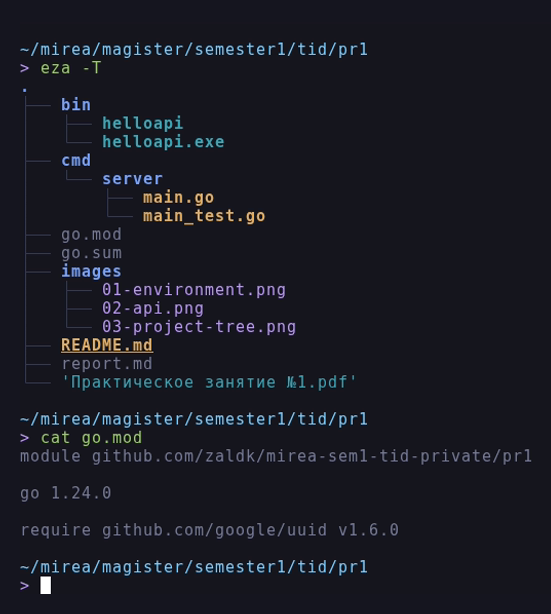
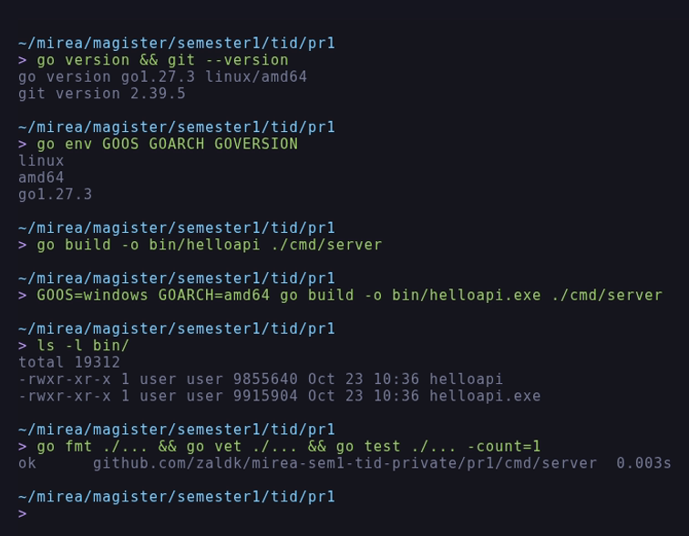
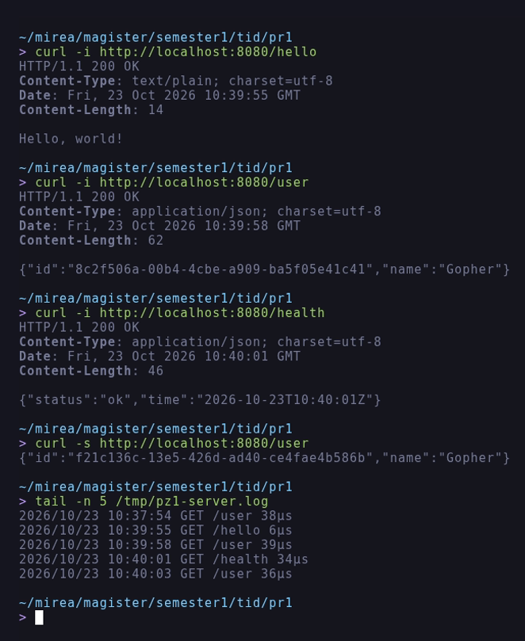

# Отчёт по практическому занятию 1

**Тема:** Установка и настройка окружения Go. Минимальный HTTP-сервис на `net/http`.

**Дисциплина:** Технологии индустриального программирования.

**Выполнил:** Зайцев А. А., группа ЭФМО-02-26.

**Дата:** 23.10.2026.

## Цель работы

Развернуть рабочее окружение Go, создать минимальный HTTP-сервис на `net/http`,
подключить и использовать внешнюю зависимость (генерация UUID), собрать и
проверить приложение.

## Задачи

1. Установить Go и Git, проверить версии.
2. Инициализировать модуль Go в новом проекте.
3. Реализовать HTTP-сервер с маршрутами `/hello` (текст) и `/user` (JSON).
4. Подключить внешнюю библиотеку (генерация UUID) и использовать её в `/user`.
5. Запустить и проверить ответы `curl`/браузером.
6. Собрать бинарник `.exe` и подготовить README и отчёт.

## Окружение

| Инструмент | Версия |
| :--- | :--- |
| ОС | Debian GNU/Linux 12 (bookworm), x86_64 |
| Go | `go1.27.3 linux/amd64` |
| Git | `2.39.5` |
| Внешняя библиотека | `github.com/google/uuid v1.6.0` |

Работа выполнялась в каталоге `~/mirea/magister/semester1/tid/pr1`.

## Ход работы

### 1. Проверка версий и инициализация модуля

```
go version     -> go version go1.27.3 linux/amd64
git --version  -> git version 2.39.5
go mod init github.com/zaldk/mirea-sem1-tid-private/pr1
```

В проекте появились `go.mod` (имя модуля и версия Go) и, после `go get`,
`go.sum` с контрольными суммами зависимостей.

### 2. Структура проекта

Ниже приведена структура проекта; полное дерево, построенное командой
`eza -T`, показано на рисунке 1.

```
pr1/
|-- cmd/server/
|   |-- main.go
|   `-- main_test.go
|-- images/
|-- go.mod
|-- go.sum
|-- README.md
`-- report.md
```

Точка входа вынесена в `cmd/server`, что соответствует рекомендованной
структуре проекта из задания. На рисунке 1 показано дерево каталогов,
построенное командой `eza -T`, и содержимое `go.mod`.



*Рисунок 1 - Структура проекта и зафиксированные зависимости*

### 3. Реализация сервера

Роутер собран на `http.NewServeMux()` с method-pattern'ами. Порт читается из
переменной окружения `APP_PORT` (по умолчанию `8080`); это "звёздочка"
задания.

```go
port := os.Getenv("APP_PORT")
if port == "" {
	port = "8080"
}
srv := &http.Server{
	Addr:              ":" + port,
	Handler:           newRouter(),
	ReadHeaderTimeout: 5 * time.Second,
}
log.Printf("Starting on %s ...", addr)
```

Маршруты:

```go
mux.HandleFunc("GET /hello", handleHello)
mux.HandleFunc("GET /user", handleUser)
mux.HandleFunc("GET /health", handleHealth)
```

`/user` формирует JSON через `json.NewEncoder` и всегда выставляет
`Content-Type: application/json; charset=utf-8`; идентификатор генерируется
внешней библиотекой:

```go
func handleUser(w http.ResponseWriter, _ *http.Request) {
	w.Header().Set("Content-Type", "application/json; charset=utf-8")
	_ = json.NewEncoder(w).Encode(user{
		ID:   uuid.NewString(),
		Name: "Gopher",
	})
}
```

Дополнительно реализованы:

- `GET /health` с JSON `{"status":"ok","time":"<RFC3339>"}` (бонус задания);
- middleware логирования метода, пути и длительности запроса (бонус задания).

```go
func logRequests(next http.Handler) http.Handler {
	return http.HandlerFunc(func(w http.ResponseWriter, r *http.Request) {
		start := time.Now()
		next.ServeHTTP(w, r)
		log.Printf("%s %s %s", r.Method, r.URL.Path, time.Since(start).Round(time.Microsecond))
	})
}
```

### 4. Подключение внешней зависимости

```
go get github.com/google/uuid@latest   -> added github.com/google/uuid v1.6.0
go mod tidy
```

`go.sum` зафиксировал контрольную сумму модуля, версия видна в `go.mod`
(рисунок 1).

### 5. Сборка и проверка

```
go build -o bin/helloapi ./cmd/server
GOOS=windows GOARCH=amd64 go build -o bin/helloapi.exe ./cmd/server
go fmt ./...   (без вывода, код уже отформатирован)
go vet ./...   (без замечаний)
go test ./...  (ok ... 0.003s)
```

На рисунке 2 приведены версии инструментов, сборка ELF-бинарника и Windows
`.exe`, а также результаты `go fmt`, `go vet` и `go test`.



*Рисунок 2 - Версии инструментов, сборка бинарников, проверки кода*

### 6. Проверка маршрутов

Сервер запущен собранным бинарником `./bin/helloapi`, запросы выполнялись
через `curl`.

| Метод и маршрут | Ожидалось | Получено |
| :--- | :--- | :--- |
| `GET /hello` | 200, текст `Hello, world!` | 200, `text/plain; charset=utf-8`, `Hello, world!` |
| `GET /user` | 200, JSON с UUID | 200, `application/json; charset=utf-8`, `{"id":"8c2f506a-00b4-4cbe-a909-ba5f05e41c41","name":"Gopher"}` |
| `GET /health` | 200, JSON со временем | 200, `{"status":"ok","time":"2026-10-23T10:40:01Z"}` |
| `POST /user` | 405 | 405 Method Not Allowed (проверено тестом) |

На рисунке 3 приведены ответы маршрутов с заголовками и журнал запросов
сервера.



*Рисунок 3 - Ответы маршрутов и логирование запросов*

Каждый UUID уникален: два последовательных запроса вернули
`8c2f506a-00b4-4cbe-a909-ba5f05e41c41` и `f21c136c-13e5-426d-ad40-ce4fae4b586b`.

## Итоговая проверка (чек-лист)

- [x] Сервер запускается через `go run ./cmd/server` и через собранный бинарник.
- [x] `/hello` возвращает 200 и текст.
- [x] `/user` возвращает 200, валидный JSON и UUID.
- [x] В проекте есть `go.mod` и `go.sum`, внешняя зависимость реально используется.
- [x] `go fmt` и `go vet` проходят без ошибок и предупреждений.
- [x] README содержит команды запуска и примеры запросов.

## Ответы на вопросы на защиту

**1. Что такое модуль Go? Роль `go.mod` и `go.sum`.**
Модуль - набор пакетов с общим путём импорта и версией, задаваемой в `go.mod`
(имя модуля, версия Go, требования к зависимостям, `replace`/`exclude`).
`go.sum` хранит хэши модулей и проверяет целостность загружаемых зависимостей,
защищая от подмены кода.

**2. Отличия `go run` и `go build`.**
`go run` компилирует программу во временный каталог и сразу запускает её, что
удобно при разработке. `go build` создаёт постоянный бинарник в текущем
каталоге (или в `-o`), который можно распространять и запускать без Go.

**3. Как формируется JSON-ответ и зачем `Content-Type: application/json`?**
`json.NewEncoder(w).Encode(v)` сериализует структуру в поток. Заголовок
`Content-Type` сообщает клиенту формат тела, иначе браузер или клиент может
трактовать ответ как текст и не распарсить JSON.

**4. Как подключить и зафиксировать стороннюю библиотеку?**
`go get github.com/google/uuid@latest` добавляет требование в `go.mod` и
хэши в `go.sum`; `go mod tidy` удаляет неиспользуемые зависимости и
дополняет недостающие. Импорт в коде обычный:
`import "github.com/google/uuid"`.

**5. Где и как читать переменные окружения для конфигурации порта?**
`os.Getenv("APP_PORT")` в `main`; при пустом значении подставляется
значение по умолчанию. В PowerShell переменная задаётся
`$env:APP_PORT="8081"`, в bash - `APP_PORT=8081 go run ./cmd/server`.

## Вывод

Окружение Go настроено, модуль инициализирован, сервис собирается и
запускается как ELF-, так и Windows-бинарником. Все три маршрута отвечают
корректно, UUID генерируется внешней библиотекой, зависимости зафиксированы.
Дополнительно реализованы `/health` с временем в RFC3339, настраиваемый порт
и логирование запросов.
