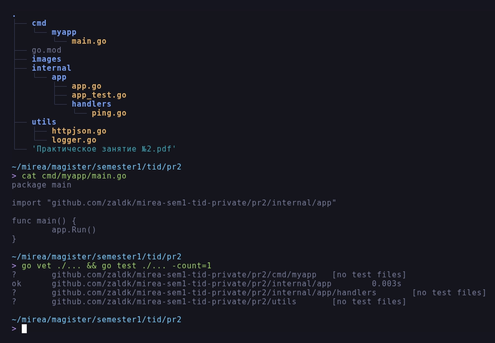
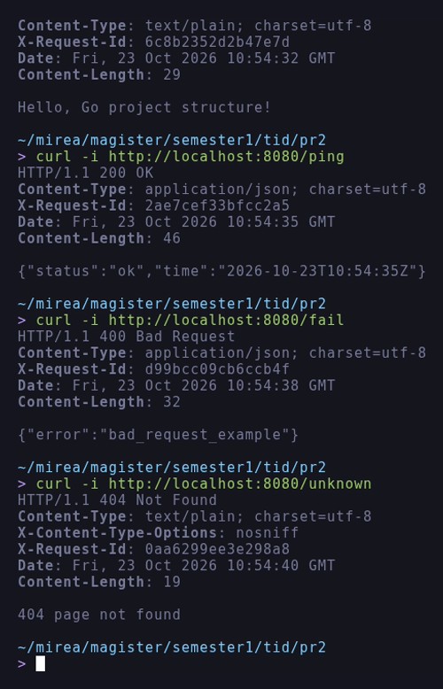
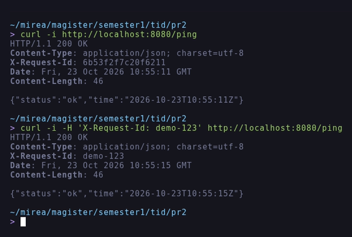
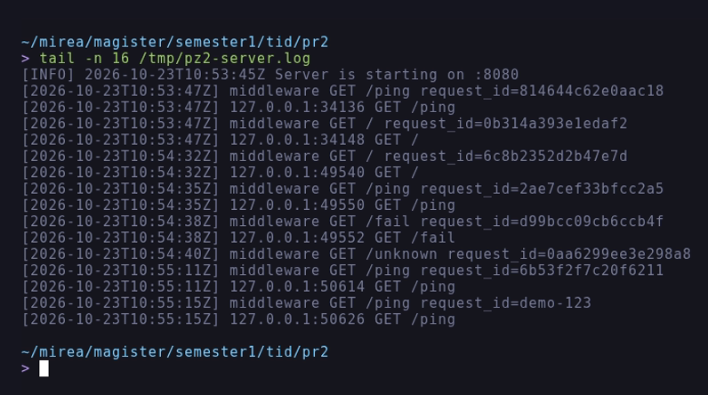

# Отчёт по практическому занятию 2

**Тема:** Структура Go-проекта (cmd, internal, utils), логирование и единый
формат JSON-ошибок.

**Дисциплина:** Технологии индустриального программирования.

**Выполнил:** Зайцев А. А., группа ЭФМО-02-26.

**Дата:** 23.10.2026.

## Цель работы

Разобрать назначение ключевых каталогов Go-проекта (cmd, internal, pkg и др.),
разложить код по "правильным" местам, собрать минимальный скелет проекта и
запустить пустой `main.go`.

## Задачи

1. Создать скелет проекта с каталогами `cmd/myapp`, `internal/app`, `utils`.
2. Сделать `main.go` минимальным: только вызов `internal/app.Run()`.
3. Реализовать маршруты `/` (текст) и `/ping` (JSON) с логированием запросов.
4. Выполнить упражнения:
   - A: `X-Request-Id` - генерировать, если заголовка нет, и возвращать в ответе;
   - B: единый формат JSON-ошибок (`utils.WriteErr`) и маршрут `/fail`;
   - C: вынести `/ping` в отдельный пакет `internal/app/handlers`.
5. Проверить работу запросами `curl`, оформить отчёт.

## Окружение

| Инструмент | Версия |
| :--- | :--- |
| ОС | Debian GNU/Linux 12 (bookworm), x86_64 |
| Go | `go1.27.3 linux/amd64` |
| Git | `2.39.5` |

Работа выполнялась в каталоге `~/mirea/magister/semester1/tid/pr2`.

## Ход работы

### 1. Скелет проекта

```
mkdir myapp && cd myapp
git init
go mod init github.com/zaldk/mirea-sem1-tid-private/pr2
mkdir -p cmd/myapp internal/app utils
```

Итоговая структура (команда `eza -T --git-ignore`, рисунок 1):

```
pr2/
|-- cmd/myapp/main.go
|-- internal/app/app.go
|-- internal/app/app_test.go
|-- internal/app/handlers/ping.go
|-- utils/httpjson.go
|-- utils/logger.go
|-- go.mod
|-- README.md
`-- report.md
```

`cmd/` содержит только точку входа, `internal/` - приватный код приложения
(компилятор Go запрещает импортировать его извне), `utils/` - небольшие общие
хелперы логирования и JSON-ответов. Каталог `pkg/` намеренно не создавался:
для учебного проекта публичных библиотек нет.



*Рисунок 1 - Структура проекта, минимальный main.go, go vet и go test*

Точка входа действительно минимальна:

```go
package main

import "github.com/zaldk/mirea-sem1-tid-private/pr2/internal/app"

func main() {
	app.Run()
}
```

### 2. Логирование и маршруты

`utils/logger.go` печатает время, адрес клиента, метод и путь запроса, а также
отдельную строку с `request_id`. `internal/app/app.go` собирает роутер и
подключает middleware `withRequestID`:

```go
func withRequestID(next http.Handler) http.Handler {
	return http.HandlerFunc(func(w http.ResponseWriter, r *http.Request) {
		id := r.Header.Get("X-Request-Id")
		if id == "" {
			id = utils.NewID16()
		}
		w.Header().Set("X-Request-Id", id)
		utils.LogRequestID(id, r.Method, r.URL.Path)
		next.ServeHTTP(w, r)
	})
}
```

Порт берётся из переменной окружения `PORT` (по умолчанию `8080`):

```go
func Port() string {
	if p := os.Getenv("PORT"); p != "" {
		return p
	}
	return "8080"
}
```

### 3. Единый формат ошибок (упражнение B)

```go
func WriteJSON(w http.ResponseWriter, code int, v any) {
	w.Header().Set("Content-Type", "application/json; charset=utf-8")
	w.WriteHeader(code)
	_ = json.NewEncoder(w).Encode(v)
}

func WriteErr(w http.ResponseWriter, code int, msg string) {
	WriteJSON(w, code, JSONError{Error: msg})
}
```

Маршрут `/fail` использует `WriteErr` и возвращает `400` с телом
`{"error":"bad_request_example"}`.

### 4. Вынос обработчика (упражнение C)

`internal/app/handlers/ping.go` содержит обработчик `/ping`, который
подключается в `app.go` строкой:

```go
mux.HandleFunc("GET /ping", handlers.Ping)
```

## Результаты проверки

Запросы выполнялись командой `curl` при запущенном сервере
(`PORT=8080 ./bin/myapp`).

| Метод и маршрут | Ожидалось | Получено |
| :--- | :--- | :--- |
| `GET /` | 200, текст `Hello, Go project structure!` | 200, `text/plain; charset=utf-8` |
| `GET /ping` | 200, JSON `{"status":"ok","time":"..."}` | 200, `application/json; charset=utf-8` |
| `GET /fail` | 400, JSON ошибки | 400, `{"error":"bad_request_example"}` |
| `GET /unknown` | 404 | 404 page not found |
| `GET /ping` без заголовка | ответ содержит сгенерированный `X-Request-Id` | `X-Request-Id: 2ae7cef33bfcc2a5` |
| `GET /ping` с `X-Request-Id: demo-123` | заголовок клиента сохраняется | `X-Request-Id: demo-123` |

На рисунке 2 приведены ответы маршрутов с заголовками, включая автоматически
сгенерированный `X-Request-Id`.



*Рисунок 2 - Ответы маршрутов и коды состояния*

На рисунке 3 отдельно показано, что клиентский `X-Request-Id` не
перезаписывается.



*Рисунок 3 - Генерация и передача X-Request-Id*

На рисунке 4 приведён журнал сервера: строки `[INFO]` при старте, строка
middleware с `request_id` и строка обработчика с адресом клиента.



*Рисунок 4 - Логирование запросов и request id*

## Проверочный чек-лист

- [x] Есть каталоги `cmd/`, `internal/`, `utils/`, `main.go` минимален.
- [x] `/` возвращает текст, `/ping` возвращает JSON со временем.
- [x] Логируются метод, путь и адрес клиента, добавлен `X-Request-Id`.
- [x] Единый формат ошибок `utils.WriteErr` и маршрут `/fail`.
- [x] `/ping` вынесен в пакет `internal/app/handlers`.
- [x] `go vet` и `go test ./...` проходят без ошибок.

## Мини-эссе: пять артефактов и их места в проекте

1. **Точка входа сервера** - `cmd/myapp/main.go`: каждый исполняемый файл
   получает свою подпапку в `cmd/`, а сам `main` остаётся тонким, поэтому
   бизнес-логика не зависит от способа запуска.
2. **HTTP-обработчики** - `internal/app/handlers`: код закрыт от внешних
   импортов, но легко тестируется и переиспользуется внутри проекта.
3. **Контракты API (OpenAPI)** - `api/`: описание контракта не должно
   смешиваться с реализацией, тогда клиенты и документация генерируются из
   одного источника.
4. **Скрипты сборки и запуска** - `scripts/`: рутинные команды вынесены из
   `README.md` в исполняемые файлы, а `Makefile` остаётся тонким и вызывает их.
5. **Миграции и схема БД** - `migrations/` (в этой работе пока не нужны):
   изменение схемы - отдельный артефакт с историей, его нельзя прятать в коде
   приложения.

Каталоги `internal/` и `utils/` появились сразу, потому что код уже делится на
приватную логику приложения и переиспользуемые хелперы. Каталог `pkg/` не
создавался: публичных библиотек у проекта нет, а пустые "на будущее" каталоги
только усложняют структуру.

## Ответы на вопросы на защиту

**1. Чем `internal/` отличается от `pkg/`?**
`internal/` - приватный код: импортировать его могут только пакеты внутри
родительского каталога, это проверяет компилятор. `pkg/` - соглашение
сообщества для публичных библиотек, доступных внешним проектам. В учебном
проекте достаточно `internal/`.

**2. Почему "много пакетов" может быть вредно?**
Дробление на мелкие пакеты увеличивает число зависимостей и риск циклов
импорта (Go их запрещает), усложняет навигацию и заставляет чаще менять
публичные сигнатуры. Пакет стоит выделять по смыслу, а не по типу файла.

**3. Зачем хранить API-контракты в `api/`, а не рядом с обработчиками?**
Контракт - это отдельный артефакт, который используют клиенты, генераторы кода
и тесты. В `api/` он версионируется независимо от реализации, и изменение
кода не "переписывает" контракт случайно.

**4. Почему `src/` в корне - плохая идея?**
В Go нет исходной директории уровня проекта: пакеты лежат там, где объявлены.
`src/` создаёт иллюзию структуры из Java/`GOPATH` и путает пути импорта.

## Вывод

Скелет проекта собран по рекомендованной схеме: тонкий `main` в `cmd/`,
приватная логика в `internal/`, хелперы в `utils/`. Реализованы маршруты `/` и
`/ping`, добавлены логирование с `request_id`, единый формат JSON-ошибок и
вынос обработчика в отдельный пакет. Все проверки проходят, поведение
подтверждено запросами `curl`.
