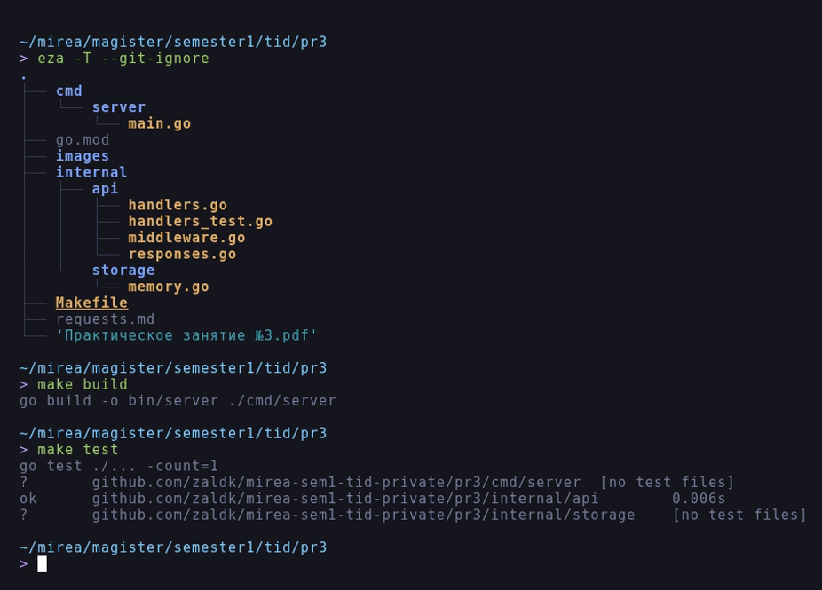
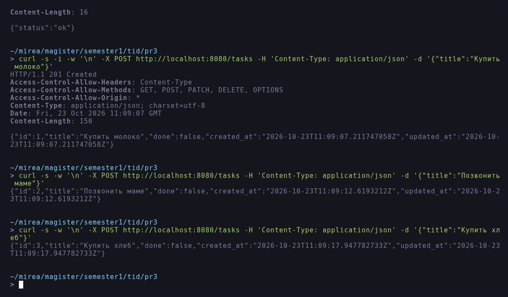
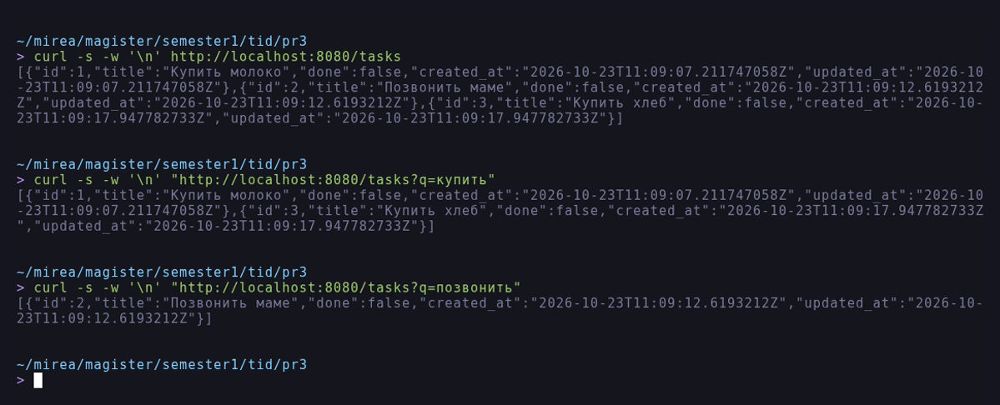
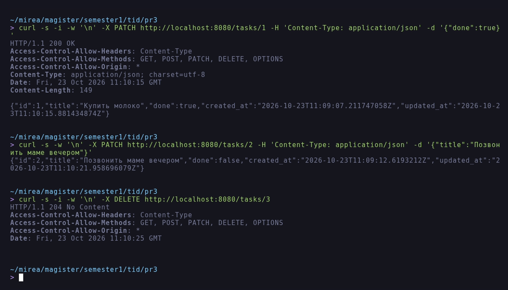
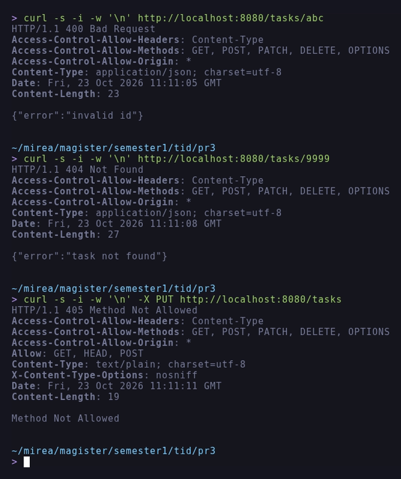
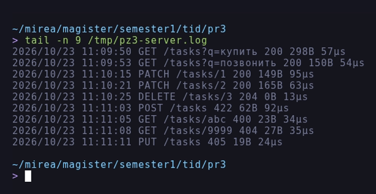
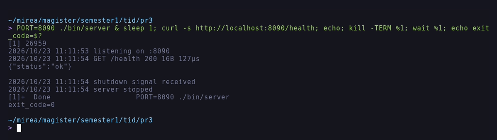

# Отчёт по практическому занятию 3

**Тема:** HTTP-сервер на стандартной библиотеке `net/http`. Обработка запросов
GET/POST/PATCH/DELETE.

**Дисциплина:** Технологии индустриального программирования.

**Выполнил:** Зайцев А. А., группа ЭФМО-02-26.

**Дата:** 23.10.2026.

## Цель работы

Освоить работу с `net/http` без сторонних фреймворков: поднять сервер,
настроить маршрутизацию через `http.ServeMux`, обрабатывать query-параметры,
path-параметры и тело запроса, формировать корректные ответы (код статуса,
заголовки, JSON), добавить middleware логирования и обработку ошибок.

## Задачи

1. Реализовать обязательные маршруты:
   - `GET /health` - `{"status":"ok"}`;
   - `GET /tasks` - список задач с фильтром `?q=`;
   - `POST /tasks` - создание задачи по `{"title":"..."}`;
   - `GET /tasks/{id}` - одна задача.
2. Сделать единый helper для JSON-ответов и ошибок.
3. Добавить middleware логирования (метод, путь, статус, время).
4. Подготовить 6-8 тестовых запросов `curl` в файле `requests.md`.
5. Дополнительная часть: `PATCH /tasks/{id}`, `DELETE /tasks/{id}`,
   валидация длины `title` (3..140), CORS-middleware.
6. Домашнее задание: порт из переменной окружения `PORT`, `Makefile` с целями
   `run`, `build`, `test`, юнит-тесты обработчиков.

## Окружение

| Инструмент | Версия |
| :--- | :--- |
| ОС | Debian GNU/Linux 12 (bookworm), x86_64 |
| Go | `go1.27.3 linux/amd64` |
| Git | `2.39.5` |

Работа выполнялась в каталоге `~/mirea/magister/semester1/tid/pr3`.

## Ход работы

### 1. Структура проекта

```
pr3/
|-- cmd/server/main.go
|-- internal/api/handlers.go
|-- internal/api/handlers_test.go
|-- internal/api/middleware.go
|-- internal/api/responses.go
|-- internal/storage/memory.go
|-- Makefile
|-- requests.md
|-- images/
|-- go.mod
|-- README.md
`-- report.md
```

На рисунке 1 показано дерево проекта, полученное командой `eza -T --git-ignore`,
и прохождение целей `make build` и `make test`.



*Рисунок 1 - Структура проекта и результаты сборки и тестов*

### 2. Хранилище и модель

`internal/storage/memory.go` содержит модель `Task` и потокобезопасное
хранилище на `map` с `sync.RWMutex`. Идентификатор - монотонный счётчик,
список всегда сортируется по `id`.

```go
type Task struct {
	ID        int64     `json:"id"`
	Title     string    `json:"title"`
	Done      bool      `json:"done"`
	CreatedAt time.Time `json:"created_at"`
	UpdatedAt time.Time `json:"updated_at"`
}
```

### 3. Единый формат ответов

`internal/api/responses.go` содержит функции `JSON`, `BadRequest`,
`Unprocessable`, `NotFound`, `Internal`. Все они выставляют
`Content-Type: application/json; charset=utf-8` и единый конверт ошибки
`{"error":"..."}`:

```go
func JSON(w http.ResponseWriter, status int, v any) {
	w.Header().Set("Content-Type", "application/json; charset=utf-8")
	w.WriteHeader(status)
	_ = json.NewEncoder(w).Encode(v)
}
```

### 4. Маршрутизация

Маршруты объявлены через method-pattern'ы `http.ServeMux`, поэтому неверный
метод автоматически даёт `405` с заголовком `Allow`:

```go
mux.HandleFunc("GET /health", h.Health)
mux.HandleFunc("GET /tasks", h.ListTasks)
mux.HandleFunc("POST /tasks", h.CreateTask)
mux.HandleFunc("GET /tasks/{id}", h.GetTask)
mux.HandleFunc("PATCH /tasks/{id}", h.PatchTask)
mux.HandleFunc("DELETE /tasks/{id}", h.DeleteTask)
```

Path-параметр достаётся через `r.PathValue("id")` и проверяется на
положительное число:

```go
id, err := strconv.ParseInt(r.PathValue("id"), 10, 64)
if err != nil || id <= 0 {
	BadRequest(w, "invalid id")
	return
}
```

### 5. Валидация и обработка ошибок

| Ситуация | Код | Тело |
| :--- | :--- | :--- |
| `Content-Type` не `application/json` | 400 | `{"error":"Content-Type must be application/json"}` |
| Битый JSON | 400 | `{"error":"invalid json: unexpected EOF"}` |
| Пустой `title` | 400 | `{"error":"title is required"}` |
| Длина `title` вне 3..140 | 422 | `{"error":"title length must be between 3 and 140 characters"}` |
| `id` не число или `<= 0` | 400 | `{"error":"invalid id"}` |
| Задача не найдена | 404 | `{"error":"task not found"}` |
| Метод не поддерживается | 405 | `Method Not Allowed` |

Валидация выполняется после `strings.TrimSpace`, а длина считается в рунах,
поэтому лимит корректно работает для кириллицы:

```go
if n := len([]rune(title)); n < minTitleLen || n > maxTitleLen {
	Unprocessable(w, "title length must be between 3 and 140 characters")
	return "", false
}
```

### 6. Middleware

`Logging` оборачивает `http.ResponseWriter` в `statusRecorder`, чтобы знать код
ответа и число байт, и печатает строку вида
`GET /tasks/1 200 149B 95us`. `CORS` добавляет
`Access-Control-Allow-Origin: *` и отвечает `204` на preflight-запросы.

```go
log.Printf("%s %s %d %dB %s",
	r.Method, r.URL.RequestURI(), rec.status, rec.bytes,
	time.Since(start).Round(time.Microsecond))
```

### 7. Graceful shutdown

`cmd/server/main.go` использует `signal.NotifyContext` и `srv.Shutdown` с
таймаутом 5 секунд; порт берётся из `PORT` (по умолчанию `8080`).

```go
ctx, stop := signal.NotifyContext(context.Background(), os.Interrupt, syscall.SIGTERM)
defer stop()
...
shutdownCtx, cancel := context.WithTimeout(context.Background(), 5*time.Second)
defer cancel()
if err := srv.Shutdown(shutdownCtx); err != nil { ... }
```

### 8. Makefile

```
make run     # PORT=8080 go run ./cmd/server
make build   # go build -o bin/server ./cmd/server
make test    # go test ./... -count=1
make fmt     # go fmt ./...
make vet     # go vet ./...
```

## Результаты тестирования

Запросы выполнялись `curl` по адресу `http://localhost:8080`; полный набор
команд приведён в `requests.md`.

| Маршрут | Запрос | Ожидалось | Получено |
| :--- | :--- | :--- | :--- |
| `GET /health` | без тела | 200 `{"status":"ok"}` | 200, совпадает |
| `POST /tasks` | `{"title":"Купить молоко"}` | 201, задача с `id` | 201, `{"id":1,...}` |
| `POST /tasks` | `{"title":"Позвонить маме"}` | 201 | 201, `{"id":2,...}` |
| `POST /tasks` | `{"title":"Купить хлеб"}` | 201 | 201, `{"id":3,...}` |
| `GET /tasks` | - | 200, три задачи | 200, `id` 1..3 |
| `GET /tasks?q=купить` | фильтр | 200, две задачи | 200, `id` 1 и 3 |
| `GET /tasks?q=позвонить` | фильтр | 200, одна задача | 200, `id` 2 |
| `GET /tasks/1` | - | 200 | 200 |
| `PATCH /tasks/1` | `{"done":true}` | 200, `done:true` | 200, `done:true` |
| `PATCH /tasks/2` | `{"title":"Позвонить маме вечером"}` | 200, новый заголовок | 200 |
| `DELETE /tasks/3` | - | 204 без тела | 204, тело пустое |
| `POST /tasks` | `{"title":"ab"}` | 422 | 422 |
| `GET /tasks/abc` | - | 400 | 400, `invalid id` |
| `GET /tasks/9999` | - | 404 | 404, `task not found` |
| `PUT /tasks` | - | 405 | 405, `Allow: GET, HEAD, POST` |

Создание задач и ответы с заголовками приведены на рисунке 2.



*Рисунок 2 - Создание задач и ответы с заголовками*

Список задач и фильтрация по подстроке (регистронезависимо, работает для
кириллицы) показаны на рисунке 3.



*Рисунок 3 - Список задач и фильтр ?q=*

Изменение задачи через `PATCH` и удаление через `DELETE` с ответом
`204 No Content` приведены на рисунке 4.



*Рисунок 4 - PATCH и DELETE*

Ошибочные сценарии - неподходящая длина `title`, нечисловой `id`,
несуществующая задача и неподдерживаемый метод - показаны на рисунке 5.



*Рисунок 5 - Ошибочные сценарии и коды ответа*

Журнал сервера с методом, путём, статусом, размером ответа и временем
обработки приведён на рисунке 6.



*Рисунок 6 - Middleware логирования*

Корректная остановка по `SIGTERM` (сначала `shutdown signal received`, затем
`server stopped`, код выхода 0) показана на рисунке 7.



*Рисунок 7 - Graceful shutdown по SIGTERM*

## Тесты

`go test ./...` покрывает создание, получение, список, фильтр, `PATCH`,
`DELETE`, валидацию, коды ошибок, `405` и CORS - 20 тестовых случаев:

```
ok  github.com/zaldk/mirea-sem1-tid-private/pr3/internal/api  0.006s
```

## Вывод

Сервер реализован на одной стандартной библиотеке, без сторонних зависимостей.
Все обязательные маршруты работают, добавлены дополнительная часть (`PATCH`,
`DELETE`, валидация 3..140, CORS) и домашнее задание (порт из `PORT`,
`Makefile`, юнит-тесты, graceful shutdown). Ошибки возвращаются в едином
JSON-формате с корректными кодами, каждый запрос попадает в журнал.

## Ответы на вопросы на защиту

**1. `http.ServeMux` против сторонних роутеров.**
Стандартный `ServeMux` начиная с Go 1.22 поддерживает методы и path-параметры
(`GET /tasks/{id}`), чего достаточно для учебного API. Сторонние роутеры
добавляют группы маршрутов, регулярные выражения, вложенные middleware и
обработку `404` в одном месте.

**2. Чем отличаются GET, POST, PUT, PATCH, DELETE?**
`GET` - чтение без побочных эффектов; `POST` - создание подчинённого ресурса;
`PUT` - полная замена ресурса; `PATCH` - частичное изменение; `DELETE` -
удаление. В работе `PATCH` меняет только переданные поля.

**3. Что такое middleware?**
Это обёртка над `http.Handler`, выполняющая сквозную задачу до или после
обработчика: логирование, CORS, авторизация, восстановление после паники,
ограничение частоты. Middleware объединяются в цепочку.

**4. Как правильно возвращать ошибки в JSON-API?**
Единым конвертом `{"error":"..."}` и корректным кодом: `400` для
некорректного формата, `422` для нарушения бизнес-правил, `404` для
отсутствующего ресурса, `405` для неподдерживаемого метода, `500` для сбоя
сервера. Заголовок `Content-Type: application/json` обязателен.

**5. Подходы к хранению данных и переход на БД.**
В учебном проекте достаточно `map` под `RWMutex`. При переходе на БД меняется
только слой хранения: обработчики начинают работать с интерфейсом
репозитория (`Create`, `Get`, `List`, `Update`, `Delete`), появляются
`context.Context`, транзакции и SQL-ошибки, которые нужно отображать в те же
коды ответа.
