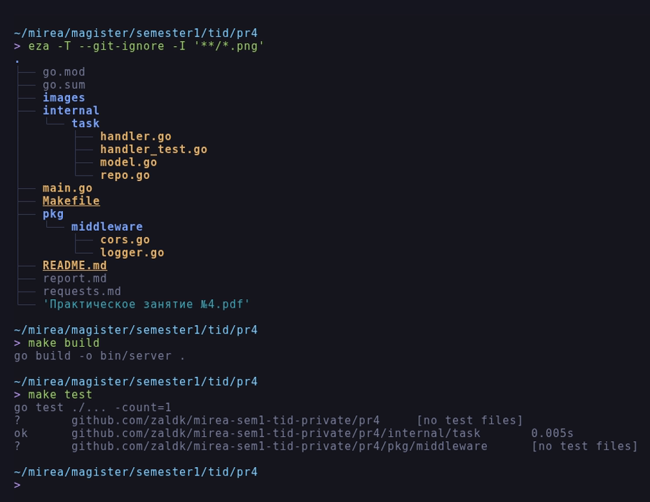
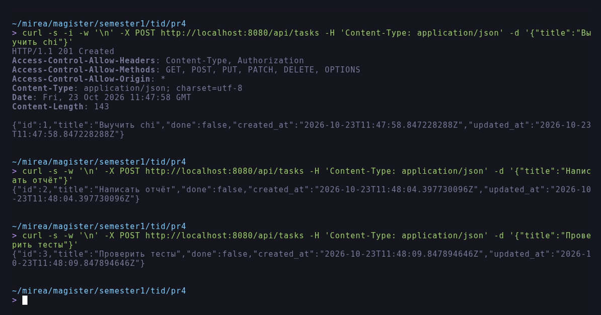
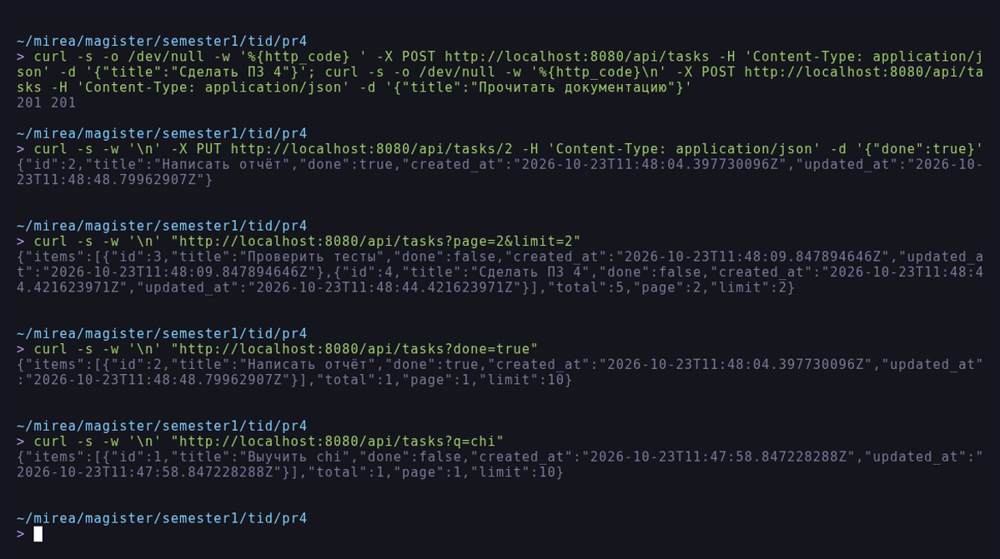
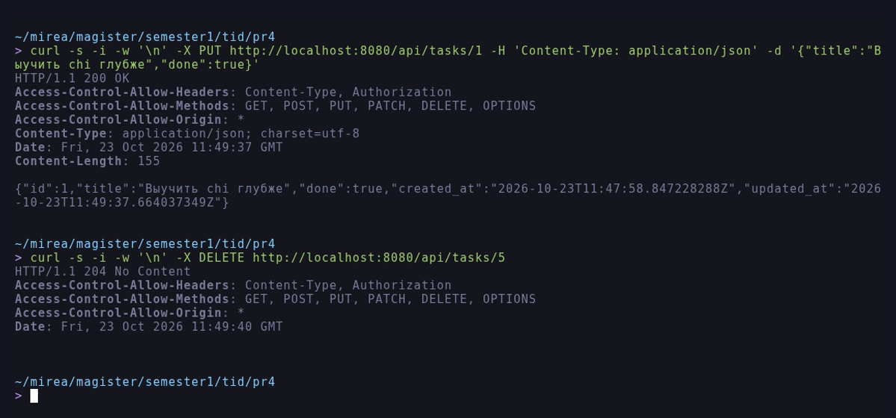
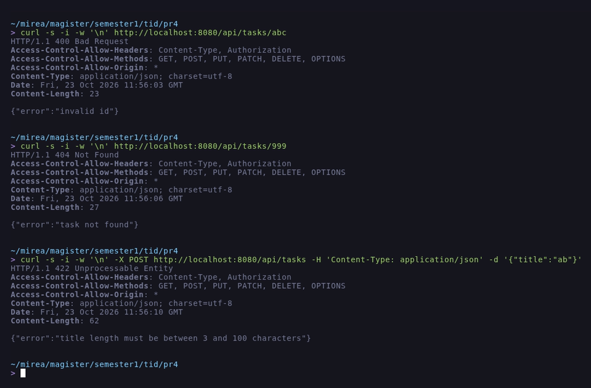
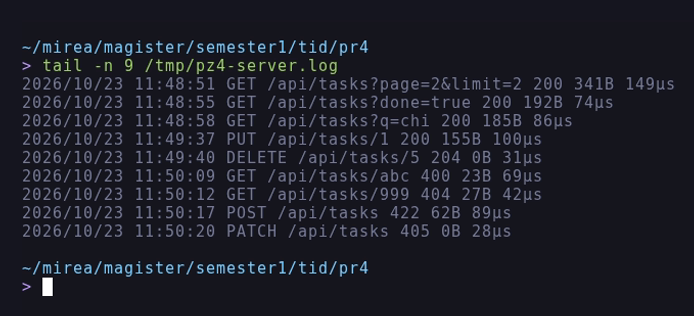
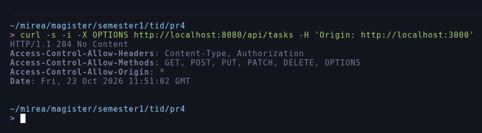

# Отчёт по практическому занятию 4

**Тема:** Маршрутизация с chi. CRUD-сервис "Список задач".

**Дисциплина:** Технологии индустриального программирования.

**Выполнил:** Зайцев А. А., группа ЭФМО-02-26.

**Дата:** 23.10.2026.

## Цель работы

Освоить маршрутизацию HTTP-запросов на роутере chi, построить REST-маршруты и
обработать методы GET/POST/PUT/DELETE, реализовать CRUD-сервис "ToDo" с
хранением в памяти, добавить middleware логирования и CORS, проверить API
запросами.

## Задачи

1. Инициализировать модуль и подключить `github.com/go-chi/chi/v5`.
2. Описать модель задачи и потокобезопасное хранилище в памяти.
3. Реализовать обработчики CRUD и подключить их через `chi.Router`.
4. Добавить middleware: `RequestID`, `Recoverer` (chi) и собственные
   `Logger`, `SimpleCORS`.
5. Проверить работу запросами `curl`, оформить отчёт.

Дополнительные задания: валидация длины `title` (3..100), пагинация
`?page=&limit=`, фильтр `?done=`, версионирование API через префикс.

## Окружение

| Инструмент | Версия |
| :--- | :--- |
| ОС | Debian GNU/Linux 12 (bookworm), x86_64 |
| Go | `go1.27.3 linux/amd64` |
| chi | `github.com/go-chi/chi/v5 v5.5.0` |
| Git | `2.39.5` |

Работа выполнялась в каталоге `~/mirea/magister/semester1/tid/pr4`.

## Ход работы

### 1. Структура проекта

```
pr4/
|-- go.mod
|-- go.sum
|-- images/
|-- internal/task/handler.go
|-- internal/task/handler_test.go
|-- internal/task/model.go
|-- internal/task/repo.go
|-- main.go
|-- Makefile
|-- pkg/middleware/cors.go
|-- pkg/middleware/logger.go
|-- README.md
|-- report.md
|-- requests.md
```

Дерево проекта, сборка и тесты показаны на рисунке 1. Дерево получено командой
`eza -T --git-ignore -I '**/*.png'`: файлы изображений исключены, чтобы дерево
было читаемым, сам каталог сохранён.



*Рисунок 1 - Структура проекта, сборка и тесты*

### 2. Модель и хранилище

```go
type Task struct {
	ID        int64     `json:"id"`
	Title     string    `json:"title"`
	Done      bool      `json:"done"`
	CreatedAt time.Time `json:"created_at"`
	UpdatedAt time.Time `json:"updated_at"`
}
```

`Repo` хранит задачи в `map` под `sync.RWMutex`, выдаёт монотонный `id`, при
чтении возвращает копии, а список сортирует по `id`. Отсутствие задачи
описывается ошибкой `ErrNotFound`, которую обработчики отображают в код 404.

### 3. Маршрутизация chi

```go
func (h *Handler) Routes() chi.Router {
	r := chi.NewRouter()
	r.Get("/", h.list)
	r.Post("/", h.create)
	r.Get("/{id}", h.get)
	r.Put("/{id}", h.update)
	r.Delete("/{id}", h.delete)
	return r
}
```

В `main.go` роутер собирается из групп и вложенных маршрутов:

```go
r.Use(chimw.RequestID)
r.Use(chimw.RealIP)
r.Use(chimw.Recoverer)
r.Use(myMW.Logger)
r.Use(myMW.SimpleCORS)

r.Get("/health", ...)

r.Route("/api", func(api chi.Router) {
	api.Mount("/tasks", h.Routes())
})
```

Параметр пути читается через `chi.URLParam(r, "id")`, поэтому путь
`/api/tasks/{id}` разбирается без ручного `strings.Split`.

### 4. Middleware

`pkg/middleware/logger.go` оборачивает `http.ResponseWriter` и печатает метод,
URI, код ответа, размер тела и время обработки:

```go
log.Printf("%s %s %d %dB %s",
	r.Method, r.URL.RequestURI(), rec.status, rec.bytes,
	time.Since(start).Round(time.Microsecond))
```

`pkg/middleware/cors.go` выставляет `Access-Control-Allow-Origin: *` и
разрешённые методы/заголовки, а на `OPTIONS` отвечает `204` без вызова
обработчика.

### 5. Валидация, пагинация и фильтры

Длина заголовка проверяется в рунах (3..100), поэтому кириллица не считается
"за" два символа:

```go
if n := len([]rune(title)); n < minTitleLen || n > maxTitleLen {
	httpError(w, http.StatusUnprocessableEntity, "title length must be between 3 and 100 characters")
	return "", false
}
```

Список поддерживает поиск `?q=`, фильтр `?done=true|false` и пагинацию
`?page=&limit=`; ответ содержит метаданные:

```json
{"items":[...],"total":5,"page":2,"limit":2}
```

Некорректные `page`, `limit` и `done` дают `400`.

### 6. Обработка ошибок и коды ответов

| Ситуация | Код | Тело |
| :--- | :--- | :--- |
| Создано | 201 | объект задачи |
| Успешно | 200 | объект или список |
| Удалено | 204 | пустое тело |
| Пустой `title` | 400 | `{"error":"title is required"}` |
| Длина вне 3..100 | 422 | `{"error":"title length must be between 3 and 100 characters"}` |
| Неверный `Content-Type` | 400 | `{"error":"Content-Type must be application/json"}` |
| Битый JSON | 400 | `{"error":"invalid json: ..."}` |
| Нечисловой `id` | 400 | `{"error":"invalid id"}` |
| Нет задачи | 404 | `{"error":"task not found"}` |
| Метод не поддерживается | 405 | заголовки `Allow: GET`, `Allow: POST` |

## Результаты тестирования

Запросы выполнялись `curl` по адресу `http://localhost:8080`; полный набор
команд приведён в `requests.md`.

| Маршрут | Запрос | Ожидалось | Получено |
| :--- | :--- | :--- | :--- |
| `GET /health` | - | 200 | 200, `{"status":"ok"}` |
| `POST /api/tasks` | `{"title":"Выучить chi"}` | 201 | 201, `id=1` |
| `POST /api/tasks` | `{"title":"Написать отчёт"}` | 201 | 201, `id=2` |
| `POST /api/tasks` | `{"title":"Проверить тесты"}` | 201 | 201, `id=3` |
| `POST /api/tasks` | `{"title":"Сделать ПЗ 4"}` | 201 | 201, `id=4` |
| `POST /api/tasks` | `{"title":"Прочитать документацию"}` | 201 | 201, `id=5` |
| `PUT /api/tasks/2` | `{"done":true}` | 200 | 200, `done=true` |
| `GET /api/tasks?page=2&limit=2` | пагинация | 200, `id` 3 и 4 | 200, `total=5` |
| `GET /api/tasks?done=true` | фильтр | 200, одна задача | 200, `id=2` |
| `GET /api/tasks?q=chi` | поиск | 200, одна задача | 200, `id=1` |
| `PUT /api/tasks/1` | новый `title` и `done` | 200 | 200, поля обновлены |
| `DELETE /api/tasks/5` | - | 204 | 204, `0B` |
| `GET /api/tasks/abc` | - | 400 | 400, `invalid id` |
| `GET /api/tasks/999` | - | 404 | 404, `task not found` |
| `POST /api/tasks` | `{"title":"ab"}` | 422 | 422 |
| `PATCH /api/tasks` | - | 405 | 405, `Allow: GET`, `Allow: POST` |
| `OPTIONS /api/tasks` | preflight | 204 | 204, заголовки CORS |

Создание задач и ответ с заголовками приведены на рисунке 2.



*Рисунок 2 - Создание задач*

Пагинация, фильтр по `done` и поиск по подстроке показаны на рисунке 3.



*Рисунок 3 - Пагинация, фильтр ?done= и поиск ?q=*

Обновление через `PUT` и удаление с ответом `204 No Content` приведены на
рисунке 4.



*Рисунок 4 - Обновление и удаление*

Ошибочные сценарии (400, 404 и 422) показаны на рисунке 5, журнал middleware -
на рисунке 6, preflight-запрос CORS - на рисунке 7. Ответ 405 с заголовком
`Allow` виден в журнале на рисунке 6 и проверяется тестом.



*Рисунок 5 - Ошибочные сценарии: 400, 404 и 422*



*Рисунок 6 - Логирование запросов*



*Рисунок 7 - Ответ на preflight-запрос*

## Тесты

`make test` запускает `go test ./... -count=1`. Тесты покрывают создание,
валидацию, получение, обновление, удаление, фильтр по `done`, пагинацию,
поиск и `405` - 9 тестовых функций с подтестами:

```
go test ./... -count=1
?   github.com/zaldk/mirea-sem1-tid-private/pr4                    [no test files]
ok  github.com/zaldk/mirea-sem1-tid-private/pr4/internal/task      0.005s
?   github.com/zaldk/mirea-sem1-tid-private/pr4/pkg/middleware      [no test files]
```

## Вывод

CRUD-сервис на chi работает: все пять операций выполняются, коды ответов и
заголовки корректны, ошибки возвращаются в едином JSON-формате. Дополнительно
реализованы пагинация, фильтр по статусу, поиск, валидация заголовка и CORS.
Использование chi упростило работу с параметрами пути и группировку маршрутов
по сравнению с ручным разбором `r.URL.Path`.

## Ответы на контрольные вопросы

**1. Чем `http.ServeMux` отличается от chi?**
Стандартный `ServeMux` с Go 1.22 умеет методы и path-параметры, но не умеет
группировать маршруты, подключать middleware к поддереву и монтировать
роутеры. chi даёт `r.Route`, `r.Mount`, `r.Group` и набор готовых
middleware (`RequestID`, `Recoverer`, `Timeout`, `Throttle`), оставаясь
совместимым с `http.Handler`.

**2. Чем отличаются GET, POST, PUT, PATCH, DELETE?**
`GET` читает данные и не меняет состояние; `POST` создаёт ресурс или запускает
действие; `PUT` заменяет ресурс, `PATCH` изменяет его частично; `DELETE`
удаляет. В работе `PUT` принимает `title` и/или `done`: не переданные поля
остаются прежними, поэтому один обработчик закрывает и полное, и частичное
обновление, а `PATCH` намеренно не подключён и даёт `405`. `PUT`/`PATCH`/
`DELETE` в REST принято делать идемпотентными.

**3. Что такое middleware и какие задачи решает?**
Это функция-обёртка над `http.Handler`, выполняющаяся до/после обработчика:
логирование, CORS, аутентификация, восстановление после паники, ограничение
частоты, сжатие. Middleware выстраиваются в цепочку и применяются к группе
маршрутов.

**4. Как правильно возвращать ошибки и коды?**
Нужно использовать единый конверт `{"error":"..."}`, корректный код (400 для
формата, 422 для бизнес-правил, 404 для отсутствующего ресурса, 405 для
метода, 409 для конфликта, 500 для сбоя) и заголовок
`Content-Type: application/json`.

**5. Подходы к хранению данных и переход на БД.**
Сейчас используется `map` под мьютексом. При переходе на базу меняется только
`Repo`: появляются `context.Context`, SQL-запросы и транзакции, а обработчики
остаются прежними, если работать через интерфейс репозитория. Ошибки БД нужно
отображать в те же HTTP-коды, а уникальные ограничения - в `409 Conflict`.
