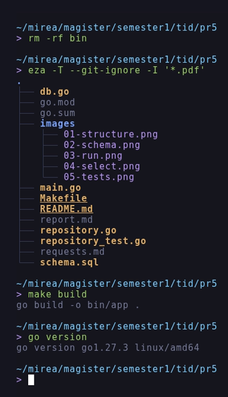
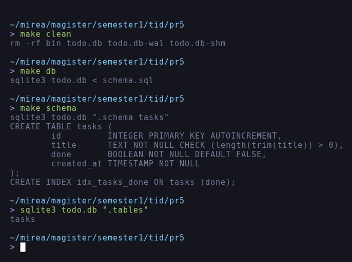
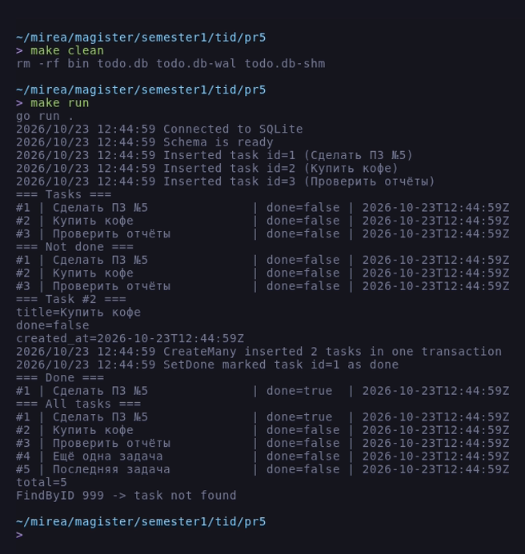
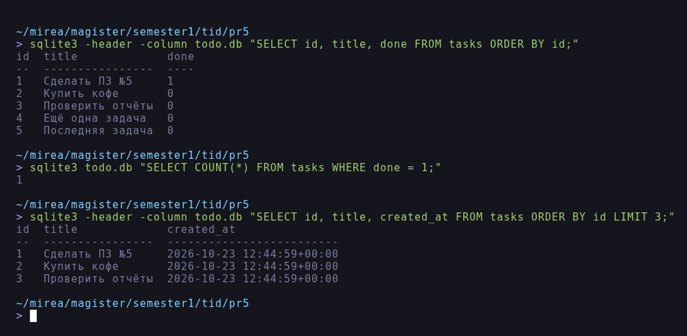
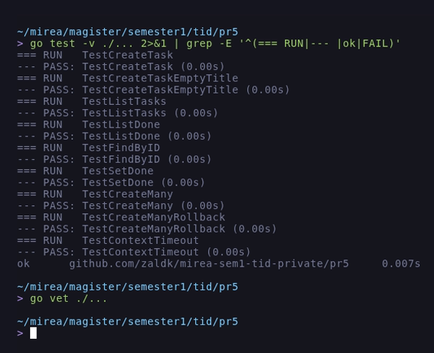

# Отчёт по практическому занятию 5

**Тема:** Подключение к базе данных через `database/sql`. Выполнение простых
запросов INSERT, SELECT.

**Дисциплина:** Технологии индустриального программирования.

**Выполнил:** Зайцев А. А., группа ЭФМО-02-26.

**Дата:** 23.10.2026.

## Цель работы

Освоить работу с реляционной базой данных из Go через `database/sql`:
настроить подключение и пул соединений, создать таблицу, выполнить
параметризованные `INSERT` и `SELECT`, разобрать работу с `context`,
`Query`, `QueryRow`, `Exec` и транзакциями.

## Задачи

1. Создать базу данных и таблицу `tasks`.
2. Подключиться из Go через `database/sql` и драйвер СУБД.
3. Настроить пул соединений и проверить соединение через `PingContext`.
4. Реализовать `CreateTask` (INSERT) и `ListTasks` (SELECT).
5. Выполнить проверочные задания: `ListDone`, `FindByID`, `CreateMany`
   через транзакцию, обосновать настройки пула.
6. Проверить записи через консольный клиент СУБД, оформить отчёт.

## Окружение

| Инструмент | Версия |
| :--- | :--- |
| ОС | Debian GNU/Linux 12 (bookworm), x86_64 |
| Go | `go1.27.3 linux/amd64` |
| Драйвер | `github.com/mattn/go-sqlite3 v1.14.52` |
| СУБД | SQLite 3 (встроена в драйвер, `CGO_ENABLED=1`) |
| Git | `2.39.5` |

Работа выполнялась в каталоге `~/mirea/magister/semester1/tid/pr5`.

Задание разрешает выбрать конкретную СУБД; выбран SQLite, потому что он
не требует отдельного сервера, а весь код при этом остаётся на
`database/sql` с плейсхолдерами, пулом соединений и `context`.

## Ход работы

### 1. Структура проекта

```
pr5/
|-- db.go
|-- go.mod
|-- go.sum
|-- images/
|   |-- 01-structure.png
|   |-- 02-schema.png
|   |-- 03-run.png
|   |-- 04-select.png
|   `-- 05-tests.png
|-- main.go
|-- Makefile
|-- README.md
|-- report.md
|-- repository.go
|-- repository_test.go
|-- requests.md
`-- schema.sql
```

Дерево проекта, сборка и версия Go показаны на рисунке 1 (`eza -T
--git-ignore`, `make build`, `go version`).



*Рисунок 1 - Структура проекта, сборка и версия Go*

### 2. Подключение и пул соединений

`db.go` открывает пул и проверяет соединение с таймаутом:

```go
func openDB(dsn string) (*sql.DB, error) {
	db, err := sql.Open("sqlite3", dsn)
	if err != nil {
		return nil, err
	}

	db.SetMaxOpenConns(10)
	db.SetMaxIdleConns(5)
	db.SetConnMaxLifetime(30 * time.Minute)

	ctx, cancel := context.WithTimeout(context.Background(), 2*time.Second)
	defer cancel()

	if err := db.PingContext(ctx); err != nil {
		_ = db.Close()
		return nil, err
	}

	log.Println("Connected to SQLite")
	return db, nil
}
```

`sql.Open` не открывает соединение, а создаёт пул: реальные соединения
появляются при первом запросе, поэтому ошибки подключения ловит
`PingContext`. Строка подключения берётся из `DATABASE_URL`, по умолчанию
`file:todo.db?_journal_mode=WAL&_busy_timeout=5000&_foreign_keys=1`.

Схема создаётся отдельной функцией и повторяет SQL из задания:

```sql
CREATE TABLE IF NOT EXISTS tasks (
	id         INTEGER PRIMARY KEY AUTOINCREMENT,
	title      TEXT NOT NULL CHECK (length(trim(title)) > 0),
	done       BOOLEAN NOT NULL DEFAULT FALSE,
	created_at TIMESTAMP NOT NULL
);

CREATE INDEX IF NOT EXISTS idx_tasks_done ON tasks (done);
```

Создание таблицы и просмотр схемы в консольном клиенте показаны на
рисунке 2.



*Рисунок 2 - Создание таблицы `tasks` и её схема*

### 3. INSERT с возвратом идентификатора

```go
func (r *Repo) CreateTask(ctx context.Context, title string) (int, error) {
	const q = `INSERT INTO tasks (title, done, created_at) VALUES (?, FALSE, ?) RETURNING id;`

	var id int
	if err := r.DB.QueryRowContext(ctx, q, title, now()).Scan(&id); err != nil {
		return 0, err
	}
	return id, nil
}
```

Заголовок передаётся плейсхолдером `?`, значение `done` берётся по
умолчанию из схемы, время создания вычисляется в Go и тоже передаётся
параметром. `QueryRowContext` + `Scan` возвращают сгенерированный `id`
одним запросом (SQLite поддерживает `RETURNING`).

### 4. SELECT и обход строк

```go
func (r *Repo) ListTasks(ctx context.Context) ([]Task, error) {
	const q = `SELECT id, title, done, created_at FROM tasks ORDER BY id;`

	rows, err := r.DB.QueryContext(ctx, q)
	if err != nil {
		return nil, err
	}
	defer rows.Close()

	out := make([]Task, 0, 8)
	for rows.Next() {
		var t Task
		if err := rows.Scan(&t.ID, &t.Title, &t.Done, &t.CreatedAt); err != nil {
			return nil, err
		}
		out = append(out, t)
	}
	return out, rows.Err()
}
```

Обязательные элементы: `defer rows.Close()`, проверка ошибки `Scan` и
возврат `rows.Err()` после цикла. Для одной строки используется
`QueryRowContext`:

```go
func (r *Repo) FindByID(ctx context.Context, id int) (*Task, error) {
	const q = `SELECT id, title, done, created_at FROM tasks WHERE id = ?;`

	var t Task
	err := r.DB.QueryRowContext(ctx, q, id).Scan(&t.ID, &t.Title, &t.Done, &t.CreatedAt)
	if errors.Is(err, sql.ErrNoRows) {
		return nil, ErrNotFound
	}
	...
}
```

### 5. Проверочные задания

`ListDone` фильтрует по статусу одним параметром:

```go
const q = `SELECT id, title, done, created_at FROM tasks WHERE done = ? ORDER BY id;`
rows, err := r.DB.QueryContext(ctx, q, done)
```

`CreateMany` пишет пачку заголовков в одной транзакции: при ошибке
любого `INSERT` выполняется `Rollback`, и база остаётся в прежнем
состоянии.

```go
func (r *Repo) CreateMany(ctx context.Context, titles []string) error {
	tx, err := r.DB.BeginTx(ctx, nil)
	if err != nil {
		return err
	}
	defer func() { _ = tx.Rollback() }()

	const q = `INSERT INTO tasks (title, done, created_at) VALUES (?, FALSE, ?);`

	for i, title := range titles {
		if _, err := tx.ExecContext(ctx, q, title, now()); err != nil {
			return fmt.Errorf("insert %d (%q): %w", i+1, title, err)
		}
	}

	return tx.Commit()
}
```

`SetDone` демонстрирует `Exec` и проверку количества затронутых строк:

```go
const q = `UPDATE tasks SET done = ? WHERE id = ?;`

res, err := r.DB.ExecContext(ctx, q, done, id)
...
affected, err := res.RowsAffected()
if affected == 0 {
	return ErrNotFound
}
```

### 6. Запуск приложения

`main.go` открывает пул, создаёт схему, вставляет три задачи, печатает
список, ищет задачу по `id`, выполняет массовую вставку, отмечает
первую задачу выполненной и выводит итог.



*Рисунок 3 - Вывод `make run`: вставка и список задач*

### 7. Проверка через консольный клиент

После запуска те же записи видны в базе: три задачи, две из массовой
вставки, у первой `done = 1`. Отдельно проверено количество выполненных
задач и выборка с ограничением по количеству строк.



*Рисунок 4 - Проверка записей через `SELECT`*

### 8. Тесты

`repository_test.go` проверяет создание задачи, ограничение `CHECK` на
пустой заголовок, список, фильтр по `done`, поиск по `id` вместе с
`ErrNotFound`, изменение статуса, массовую вставку и её откат, а также
истечение `context`.



*Рисунок 5 - `go test -v` и `go vet`*

## Результаты тестирования

| Проверка | Ожидалось | Получено |
| :--- | :--- | :--- |
| `openDB` на существующем файле | `Connected to SQLite` | `Connected to SQLite` |
| `CreateTask` три раза | `id` 1, 2, 3 | 1, 2, 3 |
| `ListTasks` | 3 строки | 3 строки, `done=false` |
| `FindByID(2)` | задача `Купить кофе` | `Купить кофе`, `done=false` |
| `FindByID(999)` | `ErrNotFound` | `task not found` |
| `CreateMany` (2 задачи) | всего 5 задач | `total=5`, `id` 4 и 5 |
| `SetDone(1, true)` | `done=true` у первой | `done=true` |
| `ListDone(true)` | одна задача | только `#1` |
| `CreateTask` с пустым `title` | ошибка `CHECK` | ошибка ограничения |
| `CreateMany` с пустым `title` | откат транзакции | `count=0` |
| `ListTasks` с истёкшим `context` | ошибка | `context deadline exceeded` |
| `go test ./...` | все тесты зелёные | `ok ... 0.007s` |
| `go vet ./...` | без замечаний | без замечаний |

## Обоснование настроек пула

Для локальной работы с одним приложением достаточно небольшого пула:
каждая открытая транзакция удерживает одно соединение, а SQLite всё равно
сериализует запись. Поэтому `SetMaxOpenConns(10)` ограничивает число
одновременных соединений и защищает от всплесков, `SetMaxIdleConns(5)`
держит часть соединений открытыми, чтобы не платить за переоткрытие файла
базы, а `SetConnMaxLifetime(30 * time.Minute)` периодически пересоздаёт
соединения и не оставляет зависших блокировок. Для серверной СУБД эти
значения подбираются по числу ядер и нагрузке, здесь важен сам принцип:
пул ограничивает ресурсы и переиспользует соединения.

## Вывод

Приложение подключается к базе через `database/sql`, создаёт схему,
выполняет параметризованные `INSERT` и `SELECT` и корректно обрабатывает
ошибки. Все проверочные задания выполнены: фильтр по `done`, поиск по
`id`, массовая вставка через транзакцию. Использование плейсхолдеров и
`context.WithTimeout` исключает SQL-инъекции и зависание запросов.

## Ответы на контрольные вопросы

**1. Что такое пул соединений `*sql.DB` и зачем его настраивать?**
`*sql.DB` - не одно соединение, а пул: он открывает соединения по мере
надобности, переиспользует их и закрывает лишние. Настройка нужна, чтобы
ограничить потребление ресурсов сервером БД, уменьшить задержку на
установку соединений и не держать соединения дольше, чем нужно.

**2. Почему используем плейсхолдеры `?`, `$1`, `$2`?**
Плейсхолдеры передают значения отдельно от текста запроса, поэтому
пользовательские данные не могут изменить структуру SQL - это защита от
SQL-инъекций. Кроме того, СУБД кэширует план запроса, а типы значений
преобразуются безопасно.

**3. Чем `Query`, `QueryRow` и `Exec` отличаются?**
`Query` возвращает `*sql.Rows` для набора строк, `QueryRow` возвращает
одну строку через `Scan` (ошибка `sql.ErrNoRows`, если строки нет), а
`Exec` применяется для `INSERT`/`UPDATE`/`DELETE` без результата и
позволяет узнать `RowsAffected`.

**4. Зачем транзакции при массовой вставке?**
Транзакция делает набор операций атомарным: либо применяются все
`INSERT`, либо ни один. Это важно при массовой вставке - иначе при ошибке
в середине в базе останется частично загруженный набор. Транзакция также
уменьшает накладные расходы на фиксацию каждого оператора.

**5. Что будет, если не закрыть `rows`?**
Соединение не вернётся в пул, и после `SetMaxOpenConns` запросов
приложение заблокируется на ожидании свободного соединения. Поэтому
используется `defer rows.Close()` сразу после успешного `Query`.
