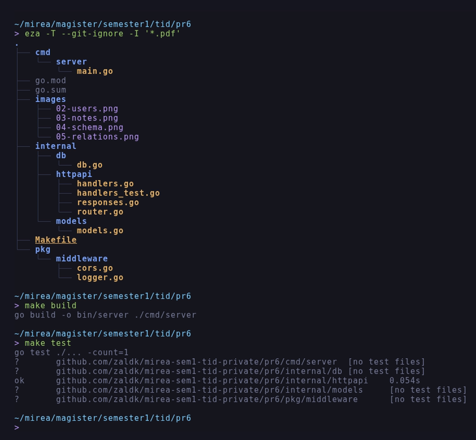
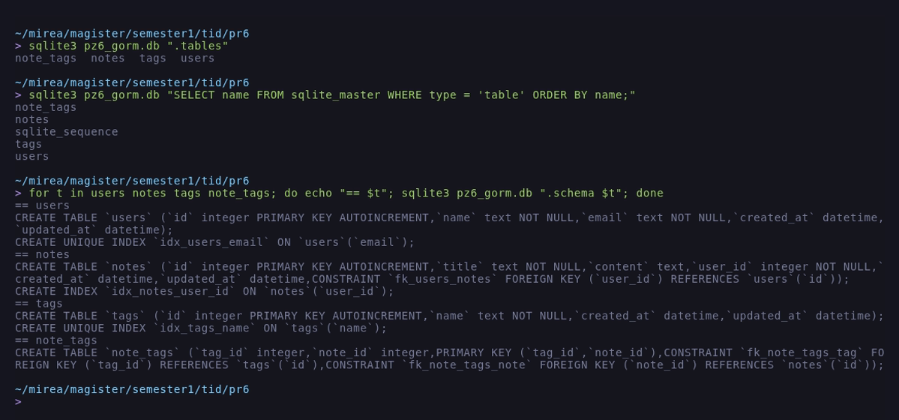
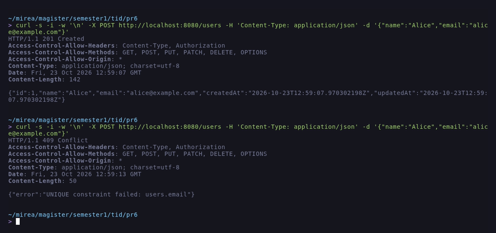
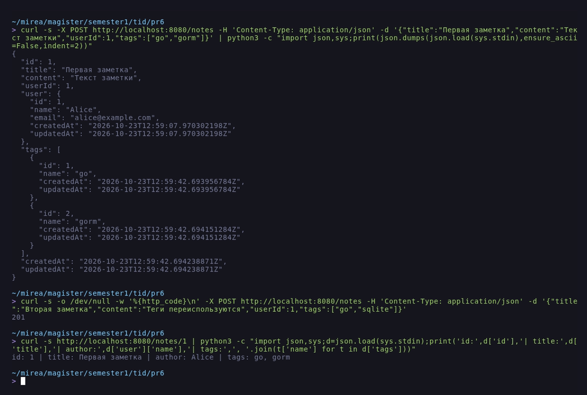
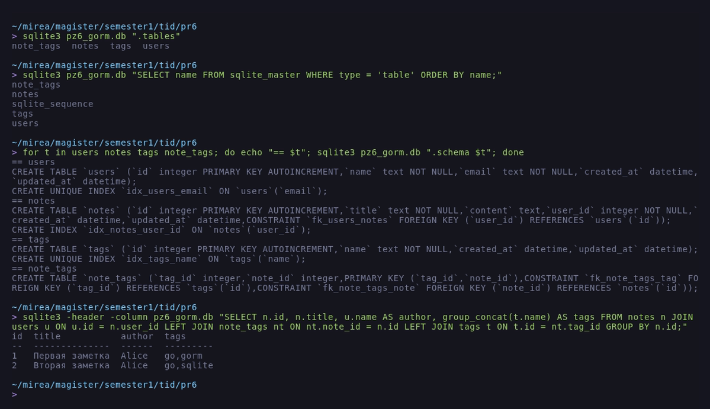
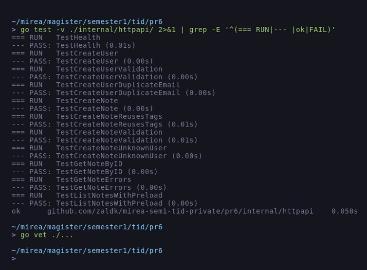
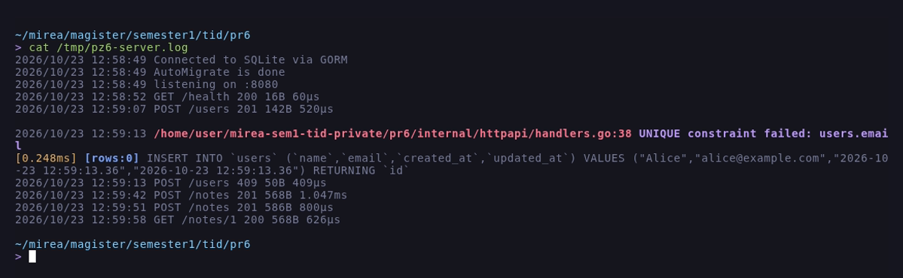

# Отчёт по практическому занятию 6

**Тема:** Использование ORM (GORM). Модели, миграции и связи между таблицами.

**Дисциплина:** Технологии индустриального программирования.

**Выполнил:** Зайцев А. А., группа ЭФМО-02-26.

**Дата:** 23.10.2026.

## Цель работы

Понять, что такое ORM и чем удобен GORM, научиться описывать модели
Go-структурами, создавать таблицы через `AutoMigrate`, работать со связями
1:N и M:N и загружать связанные данные через `Preload`, а также написать
небольшой REST для проверки результата.

## Задачи

1. Создать базу данных и подключиться к ней через GORM.
2. Описать модели `User`, `Note`, `Tag` и связи между ними.
3. Выполнить миграции через `AutoMigrate`.
4. Собрать роутер на chi и реализовать ручки `/health`, `/users`, `/notes`,
   `/notes/{id}`.
5. Проверить работу запросами `curl` и посмотреть схему БД.
6. Сделать юнит-тесты и оформить отчёт.

## Краткое описание: зачем ORM и чем помог GORM

ORM переводит структуры Go в таблицы и обратно, поэтому вместо ручного SQL
пишутся обычные операции над объектами. GORM закрывает типовой CRUD
(`Create`, `First`, `Find`, `Delete`), сам строит схему по структурам через
`AutoMigrate`, описывает связи тегами (`has many`, `many2many`) и подгружает
их через `Preload`. В этой работе GORM убрал ручные `INSERT` и `SELECT` для
трёх таблиц и внешних ключей, оставив читаемые обработчики. Минус тоже
заметен: при ошибке уникального индекса приходится разбирать текст ошибки
драйвера, а для сложной аналитики удобнее обычный SQL.

## Окружение

| Инструмент | Версия |
| :--- | :--- |
| ОС | Debian GNU/Linux 12 (bookworm), x86_64 |
| Go | `go1.27.3 linux/amd64` |
| GORM | `gorm.io/gorm v1.30.0` |
| Драйвер | `gorm.io/driver/sqlite v1.6.0` (`CGO_ENABLED=1`) |
| Роутер | `github.com/go-chi/chi/v5 v5.5.0` |
| СУБД | SQLite 3 (файл `pz6_gorm.db`) |
| Git | `2.39.5` |

Работа выполнялась в каталоге `~/mirea/magister/semester1/tid/pr6`.

В задании используется PostgreSQL; здесь применён тот же GORM с драйвером
SQLite, потому что отдельный сервер БД в учебном стенде не поднимается.
Различия сводятся к строке подключения: PostgreSQL подключается через
`gorm.io/driver/postgres` и `DB_DSN="host=... user=... dbname=..."`, код
моделей, миграций и обработчиков не меняется.

## Ход работы

### 1. Структура проекта

```
pr6/
|-- cmd/server/main.go
|-- go.mod
|-- go.sum
|-- images/
|-- internal/db/db.go
|-- internal/httpapi/handlers.go
|-- internal/httpapi/handlers_test.go
|-- internal/httpapi/responses.go
|-- internal/httpapi/router.go
|-- internal/models/models.go
|-- Makefile
|-- pkg/middleware/cors.go
|-- pkg/middleware/logger.go
|-- README.md
|-- report.md
`-- requests.md
```

Дерево проекта, сборка и тесты показаны на рисунке 1 (`eza -T --git-ignore`,
`make build`, `make test`).



*Рисунок 1 - Структура проекта, сборка и тесты*

### 2. Модели и связи

```go
type User struct {
	ID        uint      `gorm:"primaryKey" json:"id"`
	Name      string    `gorm:"size:100;not null" json:"name"`
	Email     string    `gorm:"size:200;uniqueIndex;not null" json:"email"`
	Notes     []Note    `json:"notes,omitempty"`
	CreatedAt time.Time `json:"createdAt"`
	UpdatedAt time.Time `json:"updatedAt"`
}

type Note struct {
	ID        uint      `gorm:"primaryKey" json:"id"`
	Title     string    `gorm:"size:200;not null" json:"title"`
	Content   string    `gorm:"type:text" json:"content"`
	UserID    uint      `gorm:"not null;index" json:"userId"`
	User      User      `json:"user"`
	Tags      []Tag     `gorm:"many2many:note_tags;" json:"tags"`
	CreatedAt time.Time `json:"createdAt"`
	UpdatedAt time.Time `json:"updatedAt"`
}

type Tag struct {
	ID        uint      `gorm:"primaryKey" json:"id"`
	Name      string    `gorm:"size:50;uniqueIndex;not null" json:"name"`
	Notes     []Note    `gorm:"many2many:note_tags;" json:"-"`
	CreatedAt time.Time `json:"createdAt"`
	UpdatedAt time.Time `json:"updatedAt"`
}
```

Связь 1:N описана полем `Notes []Note` у пользователя и полем `UserID` у
заметки. Связь M:N описана одинаковым тегом `gorm:"many2many:note_tags;"`
на полях `Note.Tags` и `Tag.Notes`, поэтому GORM создаёт промежуточную
таблицу `note_tags`.

### 3. Подключение и миграции

```go
func Connect() *gorm.DB {
	dsn := os.Getenv("DB_DSN")
	if dsn == "" {
		dsn = DefaultDSN
	}

	d, err := gorm.Open(sqlite.Open(dsn), &gorm.Config{
		Logger: logger.Default.LogMode(logger.Warn),
	})
	if err != nil {
		log.Fatal("connect db: ", err)
	}

	sqlDB, err := d.DB()
	...
	sqlDB.SetMaxOpenConns(20)
	sqlDB.SetMaxIdleConns(10)
	sqlDB.SetConnMaxLifetime(time.Hour)

	log.Println("Connected to SQLite via GORM")
	return d
}

func Migrate(d *gorm.DB) error {
	if err := d.AutoMigrate(&models.User{}, &models.Note{}, &models.Tag{}); err != nil {
		return err
	}
	log.Println("AutoMigrate is done")
	return nil
}
```

`AutoMigrate` создал четыре таблицы: `users`, `notes`, `tags` и
`note_tags`. Уникальные индексы `idx_users_email` и `idx_tags_name`,
внешний ключ `fk_users_notes` и составной первичный ключ `note_tags`
появились автоматически из тегов моделей.

Схема, полученная из консольного клиента, приведена на рисунке 2.



*Рисунок 2 - Схема таблиц после `AutoMigrate`*

### 4. Роутер и обработчики

```go
r := chi.NewRouter()
h := NewHandlers(d)

r.Use(middleware.Logger)
r.Use(middleware.SimpleCORS)

r.Get("/health", h.Health)
r.Post("/users", h.CreateUser)
r.Get("/users", h.ListUsers)
r.Post("/notes", h.CreateNote)
r.Get("/notes", h.ListNotes)
r.Get("/notes/{id}", h.GetNoteByID)
```

Создание пользователя проверяет поля и переводит ошибку уникального
индекса в `409 Conflict`:

```go
u := models.User{Name: ..., Email: ...}
if err := h.db.Create(&u).Error; err != nil {
	writeErr(w, http.StatusConflict, err.Error())
	return
}
writeJSON(w, http.StatusCreated, u)
```

Создание заметки ищет или создаёт теги, сохраняет заметку и возвращает её
вместе с автором и тегами:

```go
for _, name := range in.Tags {
	name = strings.TrimSpace(name)
	if name == "" {
		continue
	}
	tag := models.Tag{Name: name}
	if err := h.db.Where(models.Tag{Name: name}).FirstOrCreate(&tag).Error; err != nil {
		writeErr(w, http.StatusInternalServerError, err.Error())
		return
	}
	tags = append(tags, tag)
}
```

```go
err := h.db.Transaction(func(tx *gorm.DB) error {
	if err := tx.Create(&note).Error; err != nil {
		return err
	}
	return tx.Preload("User").Preload("Tags").First(&note, note.ID).Error
})
```

`FirstOrCreate` не создаёт дубликат тега `go`, поэтому вторая заметка
переиспользует уже существующие записи, а не добавляет новые.

### 5. Проверка запросами

Создание пользователя и повторный e-mail показаны на рисунке 3.



*Рисунок 3 - Создание пользователя и `409 Conflict` на дубликат*

Создание заметки с тегами и её чтение с автором и тегами приведены на
рисунке 4.



*Рисунок 4 - Заметка с автором и тегами*

Связи в базе проверены сводным SQL-запросом: видно, что обе заметки
принадлежат Alice, а тег `go` общий (рисунок 5).



*Рисунок 5 - Связи 1:N и M:N в базе*

### 6. Тесты

`internal/httpapi/handlers_test.go` поднимает GORM на временном файле
SQLite, выполняет `AutoMigrate` и проверяет ручки через `httptest`:
создание пользователя, валидацию, конфликт уникального e-mail, создание
заметки, переиспользование тегов, ошибки `400`/`404`, получение заметки и
список с `Preload`.



*Рисунок 6 - `go test -v` и `go vet`*

Журнал сервера с кодами ответов и текстом ошибки GORM показан на рисунке 7.



*Рисунок 7 - Логирование запросов и ошибок GORM*

## Результаты тестирования

| Запрос | Ожидалось | Получено |
| :--- | :--- | :--- |
| `GET /health` | 200 | 200, `{"status":"ok"}` |
| `POST /users` | 201, `id=1` | 201, `id=1` |
| `POST /users` (тот же e-mail) | 409 | 409, `UNIQUE constraint failed: users.email` |
| `POST /users` (пустые поля) | 400 | 400 |
| `POST /notes` | 201, автор и 2 тега | 201, `Alice`, `go`, `gorm` |
| `POST /notes` (второй набор тегов) | 201, 3 тега всего | 201, `go`, `sqlite` |
| `GET /notes/1` | 200, `Preload` | 200, автор `Alice`, теги `go`, `gorm` |
| `GET /notes/abc` | 400 | 400, `bad id` |
| `GET /notes/99` | 404 | 404, `note not found` |
| `SELECT` по связям | две заметки, автор Alice | `go,gorm` и `go,sqlite` |
| `go test ./...` | все тесты зелёные | `ok ... 0.058s` |
| `go vet ./...` | без замечаний | без замечаний |

## Проблемы и решения

1. Драйвер PostgreSQL в учебном стенде недоступен, поэтому GORM подключён к
   SQLite. Код моделей, миграций и обработчиков от этого не изменился,
   достаточно заменить драйвер и строку подключения.
2. При повторной отправке того же e-mail GORM вернул текст ошибки драйвера
   `UNIQUE constraint failed: users.email`. Ошибка разобрана и отдана
   клиенту как `409 Conflict`, а не как `500`.
3. Теги дублировались при повторном создании заметки. Решение -
   `Where(...).FirstOrCreate(...)`, которое сначала ищет запись по имени и
   создаёт её только при отсутствии.
4. Связанные данные не попадали в ответ, пока не добавлены
   `Preload("User")` и `Preload("Tags")`: по умолчанию GORM их не
   подгружает.

## Вывод

GORM позволил описать три таблицы структурами, создать схему через
`AutoMigrate` и реализовать REST без ручного SQL. Связи 1:N и M:N работают,
`Preload` возвращает автора и теги, уникальные индексы дают `409` на
дубликат. Для типового CRUD ORM ускоряет разработку, но тексты ошибок
драйвера и сложные выборки по-прежнему требуют понимания SQL.

## Ответы на контрольные вопросы

**1. Что такое ORM и зачем она нужна, если есть database/sql?**
ORM сопоставляет структуры языка с таблицами БД и сама формирует SQL.
Плюсы: меньше шаблонного кода, автоматическая параметризация запросов
(защита от инъекций), миграции и работа со связями из коробки. Минусы:
лишний слой и неочевидные запросы на сложной логике, а также привязка к
поведению конкретной ORM.

**2. Как в GORM описать связи 1:N и M:N?**
1:N описывается полем-срезом на стороне "одного" (`Notes []Note`) и внешним
ключом на стороне "многих" (`UserID uint`). M:N описывается тегом
`gorm:"many2many:note_tags;"` на срезах обеих сторон. Дополнительно
используются `primaryKey`, `not null`, `size`, `uniqueIndex` и `type:text`.

**3. Что делает AutoMigrate и когда его недостаточно?**
`AutoMigrate` создаёт отсутствующие таблицы и индексы, добавляет новые поля
и внешние ключи по моделям. Он не удаляет столбцы, не меняет типы и не
переименовывает поля, а также не переносит данные - для этого нужны
версионированные миграции (например, `golang-migrate`).

**4. Чем Preload отличается от Find/First и когда его применять?**
`Find`/`First` читают только основную таблицу, связанные поля остаются
пустыми. `Preload` выполняет отдельные запросы по связям и заполняет срезы
и структуры. Его применяют, когда связанные данные нужны в ответе API и
когда важнее предсказуемость запросов, чем `Joins` с одним большим
соединением.

**5. Как обработать нарушение уникального индекса?**
`Create` возвращает ошибку, текст которой зависит от драйвера: SQLite
сообщает `UNIQUE constraint failed: users.email`, PostgreSQL - код `23505`
(`duplicate key value violates unique constraint`). Ошибку проверяют по
коду или тексту и отвечают клиенту `409 Conflict`, а не `500`.
